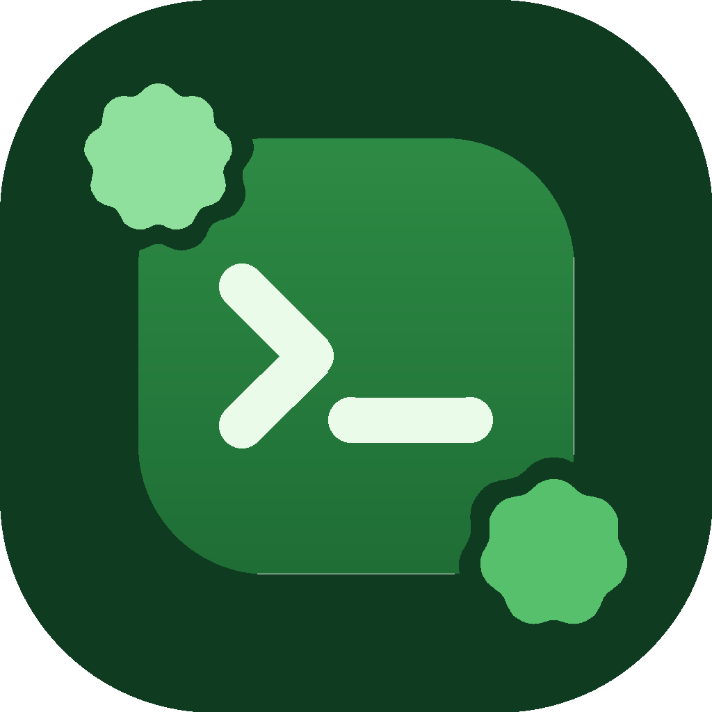

<p align="center"></p>

<h1 align="center">Sprout IDE</h1>

<p align="center">Среда разработки для телефона в стиле Material 3 Expressive — пиши код, запускай, делись и работай вместе.</p>

---

## Возможности

**Редактор**
- 24 языка: Kotlin, Java, Python, JavaScript, TypeScript, HTML, CSS, C, C++, C#, Go, Rust, Swift, Dart, PHP, Ruby, Lua, Shell, SQL, JSON, XML, YAML, Markdown и текст
- Подсветка синтаксиса, номера строк, подсветка текущей строки и парных скобок
- Автоотступы, автозакрытие скобок, кавычек и HTML-тегов
- Поиск и замена (в том числе регулярными выражениями), переход к строке, отмена и повтор
- Комментирование, дублирование и перемещение строк, вкладки, автосохранение, масштаб щипком
- Панель символов над клавиатурой
- Запуск HTML, JavaScript (с консолью), Markdown и SVG прямо в приложении

**Проекты**
- 10 шаблонов (веб-сайт, Python, Kotlin, Java, Node, C, C++, Go, Rust, пустой)
- Дерево файлов, импорт файлов и ZIP, экспорт проекта в ZIP

**Кастомизация**
- Светлая, тёмная, AMOLED-тема, цвета обоев (Material You), свой акцентный цвет, 5 стилей палитры, контраст
- Скругления, формы, масштаб интерфейса, анимации
- 4 моноширинных шрифта, 10 цветовых схем кода, десятки настроек редактора

**Аккаунт и сообщество** (вход через Google)
- Профиль: баннер (градиент или картинка), аватар, статус, описание, ссылки на Telegram, GitHub и сайт
- Бейджи и бонусы оформления, которые выдаёт администрация
- Публикация проектов — **только с открытым кодом**: без OSI-лицензии опубликовать нельзя
- Оценки (1–5 звёзд) и комментарии под проектами, клонирование чужих проектов
- **Совместные проекты**: пригласи друзей по @юзернейму и пишите один проект вместе — изменения приходят сразу, конфликты решаются в один тап

Гостевой режим работает без аккаунта: проекты и файлы хранятся на телефоне.

## Сборка

Нужны JDK 17 и Android SDK (platform 36).

```bash
./gradlew :app:assembleRelease
```

Без `app/google-services.json` приложение собирается и работает в гостевом режиме.
Чтобы включить аккаунты, создайте свой Firebase-проект: добавьте Android-приложение `com.sprout.ide` с SHA-1 вашего ключа подписи,
включите вход через Google, создайте базу Cloud Firestore и положите скачанный `google-services.json` в `app/`.
Подпись release-сборки берётся из `keystore.properties` (`storeFile`, `alias`, `password`); без него используется debug-ключ.

## Стек

Kotlin · Jetpack Compose · Material 3 Expressive · Firebase Auth + Cloud Firestore · Credential Manager

## Лицензия

Sprout IDE распространяется под лицензией **GNU General Public License v3.0** — см. [LICENSE](LICENSE).

Сторонние ресурсы:
- шрифты JetBrains Mono, Fira Code, Source Code Pro — SIL Open Font License 1.1;
- Material Icons — Apache License 2.0.
